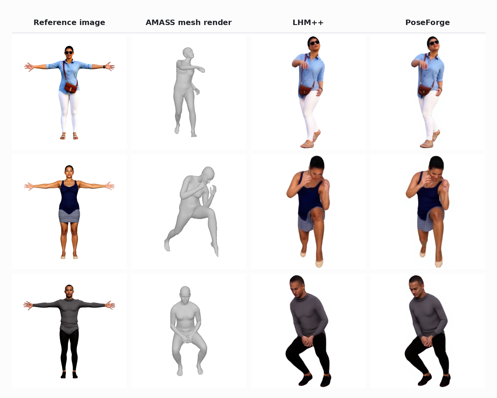
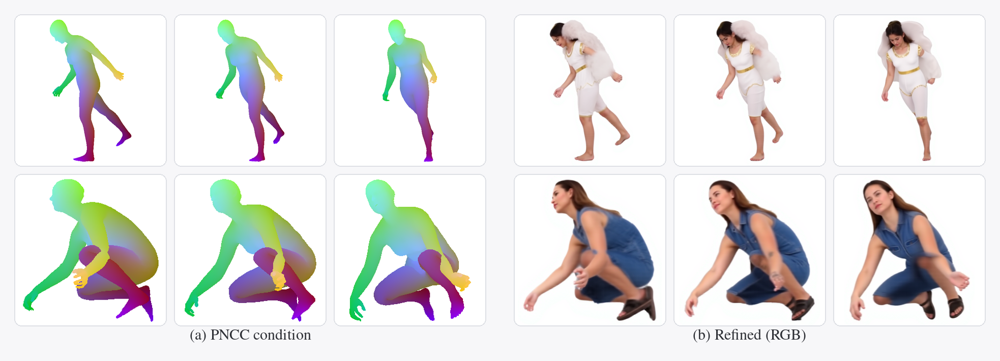
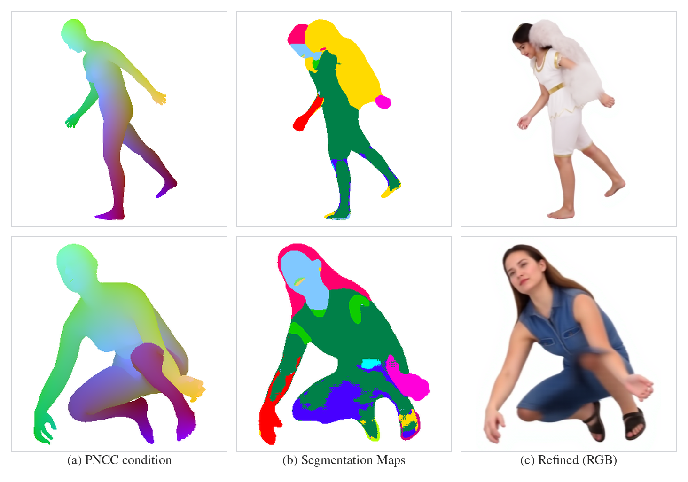
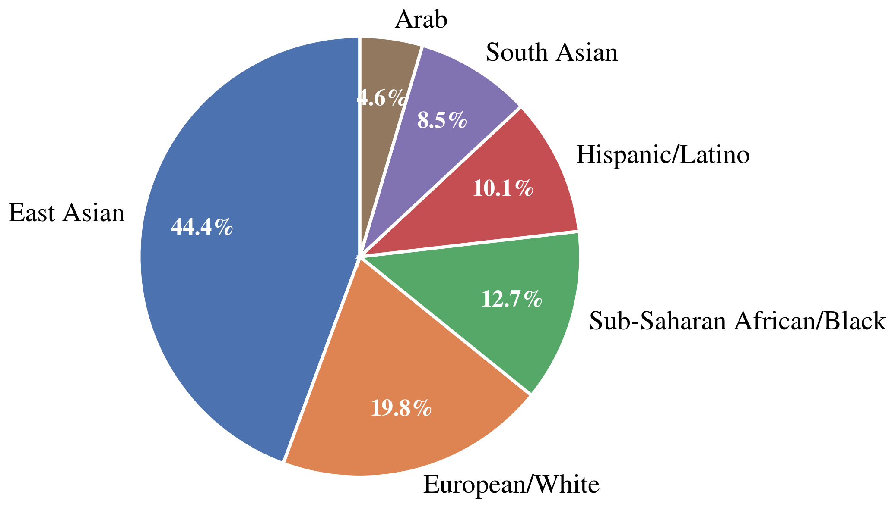
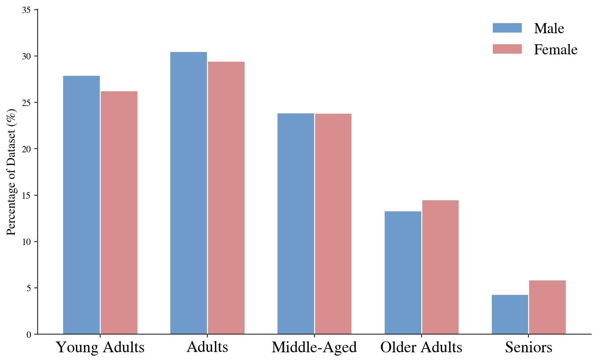
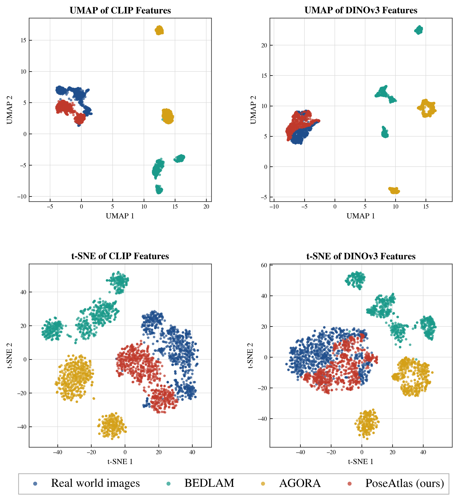

# PoseAtlas

**A Multi-View Synthetic Human Dataset with Geometrically Grounded Poses for 3D Pose Estimation**

*[HOUR Workshop @ WACV 2027](https://hour-workshop.github.io/wacv2027/) — Dataset Track*

<p>
  <a href="https://wjmenu.github.io/PoseAtlas/"></a>
  
  <a href="https://huggingface.co/datasets/wjmenu/PoseAtlas"></a>
  
</p>



## Abstract

Existing real-world human pose datasets provide limited diversity in identities, poses, and
multi-view observations, constraining the variability available for training robust 2D and 3D
pose estimation models. PoseAtlas addresses this challenge through a geometry-grounded
synthetic human dataset generation pipeline that provides diverse identities with poses sampled
from motion-capture data. Each identity is instantiated as a 3D avatar, posed and rendered from
multiple calibrated viewpoints by a feed-forward human reconstruction model. The resulting
renderings are refined by a dual spatial-control flow-matching model that improves visual
realism while conditioning on projected avatar geometry and body-part segmentation.
Reinforcement learning further promotes both pose consistency and perceptual quality. The
generated dataset contains more than 1,000,000 images from 48K synthesized identities across
eight calibrated viewpoints. Each image is paired with SMPL-X annotations derived directly from
the underlying 3D geometry. Evaluation with independent 2D pose estimators demonstrates that
the underlying geometry remains recoverable from the generated images, while training under
the SMPLer-X benchmark protocol shows that PoseAtlas transfers as training data. PoseAtlas also
achieves strong visual quality compared to other synthetic human datasets.

## Highlights

- **Large-scale multi-view dataset** — 1,000,120 images from 47,625 synthesized identities,
  each rendered from 8 calibrated viewpoints at 1024×2048 resolution, paired with SMPL-X body
  parameters and camera calibration.
- **Geometry-grounded generation** — identity, pose, and viewpoint are defined in 3D via a
  posed SMPL-X avatar *before* image synthesis, so pose/camera annotations come directly from
  the underlying geometry rather than being inferred post-hoc.
- **Dual spatial-control refinement** — a flow-matching refiner conditions jointly on
  pose-normalized geometry (PNCC) and body-part segmentation to improve photorealism while
  preserving the target pose.
- **RL-based pose preservation** — a GRPO-style reward combining pose-consistency and human
  preference terms discourages drift from the geometric reference during refinement.
- **Strong downstream transfer** — PoseAtlas + BEDLAM training mixtures are competitive with
  the strongest SMPLer-X training mixtures on AGORA / 3DPW / EHF.

## Generation Pipeline



1. **Reference identity in canonical T-pose** — a FLUX-based flow-matching generator
   synthesizes each reference identity from an attribute prompt (age, ethnicity, gender
   presentation, clothing, hairstyle, body shape), conditioned on a PNCC map of a canonical
   T-pose SMPL-X body.
2. **AMASS target pose sampling** — target poses are sampled from the AMASS motion-capture
   archive and retargeted onto each identity's SMPL-X shape.
3. **Multi-view avatar rendering** — a feed-forward avatar reconstruction model (LHM++)
   instantiates the posed identity as 3D Gaussians anchored to the canonical SMPL-X surface and
   renders it from multiple calibrated orbital viewpoints.
4. **Dual spatial-control refinement** — a condition-injection flow-matching transformer
   refines each raw render, conditioned on the PNCC map, body-part segmentation, and the
   attribute prompt, trained with a GRPO objective combining pose and preference rewards.



## Dataset Statistics

| Property | Value |
|---|---|
| Total images | 1,000,120 |
| Synthesized identities | 47,625 |
| Calibrated viewpoints per pose | 8 |
| Image resolution | 1024 × 2048 |
| Pose source | AMASS motion-capture archive |
| Annotations | SMPL-X parameters + camera calibration, derived from 3D geometry |




### Comparison to other 3D human datasets

| Type | Dataset | #Frames | IDs | #Views | Resolution | Calibrated multi-view | Generative refinement | SMPL-X |
|---|---|---|---|---|---|---|---|---|
| Real | THuman | 90K | 200 | 1 | 1920×1080 | ✗ | – | ✗ |
| Real | ZJU-MoCap | 180K | 10 | 21 | 1024×1024 | ✓ | – | ✗ |
| Real | HuMMan | 60M | 1000 | 10 | 1920×1080 | ✓ | – | ✗ |
| Real | GeneBody | 2.95M | 50 | 48 | 1024×2048 | ✓ | – | ✓ |
| Real | ActorsHQ | 40K | 8 | 160 | 4112×3008 | ✓ | – | ✗ |
| Real | DNA-Rendering | 67.5M | 1500 | 60 | 4096×3000 | ✓ | – | ✗ |
| Synthetic | SURREAL | 6.5M | 145 | 1 | 320×240 | ✗ | ✗ | ✗ |
| Synthetic | AGORA | 17K | 4240 | 1 | 3840×2160 | ✗ | ✗ | ✓ |
| Synthetic | GTA-Human | 1.4M | >600 | 1 | 1920×1080 | ✗ | ✗ | ✗ |
| Synthetic | BEDLAM | 380K | 271 | 1 | 1280×720 | ✗ | ✗ | ✓ |
| Synthetic | PoseDreamer | 500K | 500K | 1 | 1024×1024 | ✗ | ✓ | ✓ |
| Synthetic | SynBody | 1.2M | 10K | 4–8 | 1024×1024 | ✓ | ✗ | ✓ |
| **Synthetic** | **PoseAtlas (ours)** | **>1.0M** | **48K** | **8** | **1024×2048** | **✓** | **✓** | **✓** |

## Results



- **3D pose transfer (SMPLer-X protocol):** training on a PoseAtlas + BEDLAM mixture (70/30)
  performs comparably to the strongest training mixtures on AGORA and 3DPW (within 0.3 mm of
  the lowest error), reaching 77.3 PVE / 107.1 MPE on EHF versus 78.7 / 108.3 for the closest
  alternative.
- **2D pose fidelity:** independent 2D keypoint estimators recover the intended geometry with
  mean OKS ranging 0.528–0.798 (Sapiens-2B highest across all regions), evaluated against
  keypoints projected from the source SMPL-X geometry (GT is geometric, predictions are from an
  independent detector — no circularity).
- **Multi-view 3D consistency:** MPJPE decreases consistently as views are added, reaching 24.2 mm
  with all 8 calibrated views.
- **Visual quality:** Inception Score 9.58, FID 1.82 — comparable to the strongest evaluated
  synthetic human dataset baseline.

## Limitations

Fine-grained facial identity is less stable across views than body geometry/pose/clothing,
since body geometry is explicitly shared via SMPL-X while facial appearance is reconstructed
independently per view. PoseAtlas currently focuses on single-person scenes and does not model
multi-person interaction, overlap, or occlusion.

## Data & Code Availability

The PoseAtlas dataset and generation code will be released for non-commercial research use upon
publication, including rendered images, SMPL-X parameters, camera parameters, identity/pose
manifests, and an accompanying datasheet. **Code: coming soon.**

## Ethics

PoseAtlas uses entirely synthetic human identities and does not incorporate photographs,
biometric data, or other personal data from human participants. We recognize that photorealistic,
pose-controlled human image generation could be misused for impersonation or deceptive synthetic
media, and we do not condone such uses. The dataset is intended for research in human pose
estimation, 3D human perception, and related computer vision applications.

## Citation

```bibtex
@inproceedings{poseatlas2027,
  title     = {PoseAtlas: A Multi-View Synthetic Human Dataset with Geometrically Grounded Poses for 3D Pose Estimation},
  author    = {PoseAtlas Authors},
  booktitle = {Proceedings of the IEEE/CVF Winter Conference on Applications of Computer Vision (WACV) Workshops},
  year      = {2027}
}
```

## License

TBD upon release (non-commercial research use).
